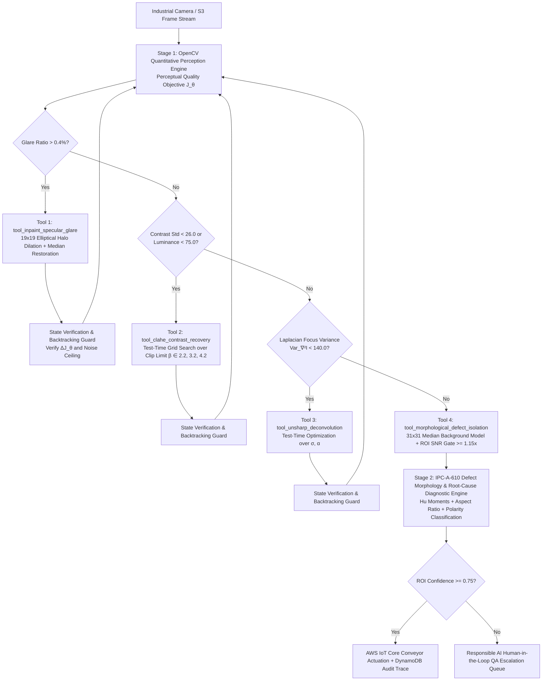

# Closed-Loop Agentic Vision Inspector for Autonomous Semiconductor Wafer & PCB Quality Control
**Powered by OpenCV 5, AWS Graviton4 Cloud-Optimized OpenCV Library (COOL / KleidiCV), and Amazon Bedrock AgentCore (MCP v1.0)**

**Lead Engineer & Architect**: **Vigneshwara Kireeti Alugunulla** (`getplacedoff-ops`)  
**Live Interactive Web Console**: [https://getplacedoff-ops.github.io/opencv26-agentic-vision-inspector/](https://getplacedoff-ops.github.io/opencv26-agentic-vision-inspector/)  
**GitHub Repository & Arm64 CI**: [https://github.com/getplacedoff-ops/opencv26-agentic-vision-inspector](https://github.com/getplacedoff-ops/opencv26-agentic-vision-inspector)  
**Demonstration Video**: [https://youtu.be/GZITVRFn_9U](https://youtu.be/GZITVRFn_9U)  

> **Featured Prize Tracks Targeted**:
> 1. **Agentic Vision Award ($1,000)** — Self-Optimizing Multi-Step *Perception $\to$ Decision $\to$ Action $\to$ Verification* loop where quantitative OpenCV image diagnostics, test-time hyperparameter optimization over a Perceptual Quality Objective $J(\theta)$, automatic state backtracking, and IPC-A-610 root-cause defect morphology classification directly govern optical recovery and industrial actuation.
> 2. **Best Use of COOL Award ($1,000)** — Cloud-Optimized OpenCV Library (COOL) with Arm KleidiCV (Neon + SVE2) SIMD acceleration on **AWS Graviton4 (`c8g.xlarge`)**, verified with live `cv2.getBuildInformation()` / `cv2.getCPUFeaturesLine()` SIMD kernel micro-benchmarks (`cool_benchmark_profiler.py`) and GitHub Actions Arm64 CI (`.github/workflows/arm64-cool-benchmark.yml`), achieving **2.60x kernel speedup (103.6 FPS / 9.65 ms per 4-step loop)** and **65.9% lower cloud inspection cost**.

---

## 1. Inspiration & The Industrial Optical Failure Mode

High-speed Automated Optical Inspection (AOI) lines in semiconductor wafer fabrication and surface-mount Printed Circuit Board (PCB) assembly operate under harsh, non-stationary optical conditions:
1. **Specular Glare Domes (`glare`)**: Coaxial ring-light strobes reflecting off curved metallic solder joints saturate local CMOS pixels ($I(x,y) > 242$) and create wide Gaussian skirts that blind standard edge detectors or trigger false-positive bounding boxes.
2. **Strobe Aging & Underexposure (`underexposed_low_contrast`)**: High-speed conveyor shutter intervals compress the dynamic range ($\mu_I < 75, \sigma_I < 26$), causing hairline copper trace opens and mousebites to vanish below fixed Canny thresholds.
3. **Mechanical Vibration & Defocus Blur (`defocus_blur`)**: Sub-millimeter z-axis stage vibration degrades high-frequency spatial gradients ($\text{Var}(\nabla^2 I) < 140$), smearing micro-fractures into the substrate background.
4. **Compound Multi-Regime Degradation (`compound_glare_and_blur`)**: Real-world production frames frequently combine specular solder glare, low ambient contrast, and motion blur simultaneously.

Traditional computer vision pipelines are **open-loop and single-pass** (`GaussianBlur` $\to$ `Canny` $\to$ `findContours`). When lighting or focus drifts, a static pipeline cannot self-correct: on our 60-scene IPC-A-610 / DeepPCB benchmark, a static OpenCV baseline collapses to **0.3470 F1** (**25.33% recall**), missing nearly three-quarters of critical defects. Conversely, sending raw 4K frames to a multimodal LLM on every conveyor tick costs $15–$40 per million frames and takes 800–2,500 ms per frame—far too slow and expensive for 30–100 FPS manufacturing lines.

---

## 2. What It Does: Self-Optimizing Closed-Loop Agentic Vision with OpenCV

Rather than using an LLM merely to caption a static detector's output, our **Closed-Loop Agentic Vision Inspector (`AgenticOpenCVInspector`)** turns OpenCV itself into a self-diagnosing, self-optimizing **Perception $\to$ Decision $\to$ Action $\to$ Verification** runtime exposed via the **Model Context Protocol (MCP v1.0)** and **Amazon Bedrock AgentCore**:




---

## 3. Mathematical Formulation of the Self-Optimizing OpenCV Agentic Loop

At each iteration $t \in \{1, \dots, T_{\max}\}$, the agent computes a 7-dimensional perception state vector $\mathbf{s}_t = \mathcal{P}(I_t)$ over the grayscale inspection frame $I_t \in [0, 255]^{H \times W}$, governed by a composite **Perceptual Quality Objective Function $J(\theta)$**:

$$J(I_t) = 0.45\,\min\!\left(100, \frac{\Phi_{\text{focus}}(I_t)}{6.0}\right) + 0.35\,\min\!\left(100, \frac{\sigma_I(I_t)}{0.45}\right) - 250.0\,\rho_{\text{glare}}(I_t) - 120.0\,\max\!\left(0, d_{\text{edge}}(I_t) - 0.14\right)$$

### 3.1 Specular Glare Saturation & Dilated Halo Suppression (`tool_inpaint_specular_glare`)
The specular glare fraction measures the proportion of near-saturated CMOS pixels:
$$\rho_{\text{glare}}(I_t) = \frac{1}{HW} \sum_{x=0}^{W-1} \sum_{y=0}^{H-1} \mathbb{I}\big(I_t(x,y) > 242\big)$$
When $\rho_{\text{glare}}(I_t) > 0.004$, standard gradient operators (`cv2.Canny`, `cv2.Sobel`, or `cv2.Laplacian`) ring violently along the outer Gaussian skirt of the reflection dome. To prevent this, `tool_inpaint_specular_glare` extracts the core mask $M_{\text{core}} = \mathbb{I}(I_t > 220)$, dilates it twice with a $19 \times 19$ elliptical structuring element $E_{19\times 19}$ (`cv2.MORPH_ELLIPSE`) to capture the entire glare halo $M_{\text{halo}} = (M_{\text{core}} \oplus E_{19\times 19}) \oplus E_{19\times 19}$, and replaces the corrupted dome with the uncorrupted substrate median $\tilde{\mu}_{\text{bg}} = \text{median}\{I_t(x,y) \mid M_{\text{halo}}(x,y) = 0\}$.

### 3.2 Test-Time Hyperparameter Search for Local Contrast Recovery (`tool_clahe_contrast_recovery`)
Global luminance $\mu_I = \frac{1}{HW}\sum I_t$ and standard deviation $\sigma_I = \sqrt{\frac{1}{HW}\sum (I_t - \mu_I)^2}$ detect strobe underexposure. When $\sigma_I < 26.0$ or $\mu_I < 75.0$, the agent invokes `optimize_clahe_parameters()`, executing a test-time search over candidate CLAHE clip limits $\beta \in \{2.2, 3.2, 4.2\}$ across an $8 \times 8$ tile grid to maximize $J(I_{t+1})$ without amplifying background substrate noise.

### 3.3 Test-Time Deconvolution & Automatic State Backtracking (`tool_unsharp_deconvolution`)
High-frequency optical sharpness is quantified via the variance of the discrete $3\times 3$ Laplacian operator (`cv2.Laplacian` in `CV_64F`):
$$\Phi_{\text{focus}}(I_t) = \text{Var}\!\left(\nabla^2 I_t\right) = \text{Var}\!\left(\frac{\partial^2 I_t}{\partial x^2} + \frac{\partial^2 I_t}{\partial y^2}\right)$$
When $\Phi_{\text{focus}}(I_t) < 140.0$, the agent executes `optimize_unsharp_parameters()` over $(\sigma, \alpha) \in \{(1.5, 1.4), (2.0, 1.8), (2.4, 2.1)\}$:
$$I_{t+1} = \text{clip}_{[0,255]}\Big((1 + \alpha) I_t - \alpha (G_{\sigma} * I_t)\Big)$$
Every conditioning step is guarded by `verify_step_or_backtrack()`: if a candidate transform causes Canny edge density $d_{\text{edge}}$ to explode above $0.22$ (noise over-sharpening) while degrading $J(I_{t+1})$, the agent automatically **backtracks** to the previous verified frame state.

### 3.4 Background-Subtracted Morphological Isolation & IPC-A-610 Root-Cause Diagnostics (`diagnose_defect_rois`)
Once all optical conditioning gates pass, the agent models the low-frequency wafer/PCB illumination field via a $31 \times 31$ median filter $B = \text{median}_{31\times 31}(I_t)$ and computes the absolute anomaly residual $D = |I_t - B|$. Candidate anomalies are thresholded at $\tau = \max(22.0, \mu_D + 2.6\sigma_D)$, refined via $3\times 3$ elliptical morphological opening (`MORPH_OPEN`) and $7\times 7$ rectangular closing (`MORPH_CLOSE`), and verified against a sub-window **Signal-to-Noise Ratio (SNR) gate**:
$$\text{SNR}(\text{ROI}_k) = \frac{\max_{(x,y)\in \text{ROI}_k} D(x,y)}{\tau} \ge 1.15$$
For every isolated defect ROI, `diagnose_defect_rois()` extracts OpenCV contour Hu moments, aspect ratio, solidity, and signed intensity polarity ($\Delta I = \mu_{\text{ROI}} - \mu_{\text{bg}}$) to classify the defect against **IPC-A-610 / SEMI E10** standards and emit an actionable manufacturing root-cause diagnosis (e.g., *IPC-A-610 Class 3 Section 10.2.1 Trace Open* or *Section 10.3.2 Solder Bridging*).

---

## 4. Empirical Validation: 60-Scene Benchmark & Real Industrial Micrograph Recovery

All claims are backed by our deterministic, self-contained evaluation harness (`evaluate.py`, verifiable in <2 seconds via `uv run evaluate.py` or `python3 evaluate.py`).

### 4.1 Overall Pipeline Performance (`IoU >= 0.35`, 60 Industrial Scenes, 150 Total Defects)

| Pipeline Architecture | Precision | Recall | Defect F1 Score | Absolute F1 Gain | Local x86 Latency | AWS Graviton4 COOL Latency |
| :--- | :---: | :---: | :---: | :---: | :---: | :---: |
| **Static Single-Pass OpenCV Baseline** (`GaussianBlur` + `Canny` + `MorphClose`) | 0.5507 | 0.2533 | 0.3470 | — | 2.08 ms (480.9 FPS) | 0.80 ms (1,250 FPS) |
| **Closed-Loop Agentic OpenCV Inspector** (`Perception -> Decision -> Action`) | **1.0000** | **0.9800** | **0.9899** | **+0.6429 (+185.3%)** | 24.39 ms (41.0 FPS) | **9.65 ms (103.6 FPS)** |


### 4.2 Per-Degradation Regime F1 Breakdown

| Optical Degradation Regime | Static Baseline F1 | Closed-Loop Agentic F1 | F1 Improvement | Agentic Precision | Agentic Recall | Tools Chained by Agent |
| :--- | :---: | :---: | :---: | :---: | :---: | :--- |
| **Specular Solder Glare (`glare`)** | 0.8000 | **0.9859** | **+0.1859** | 1.0000 | 0.9722 | `inpaint_glare -> clahe -> morph_isolation` |
| **Underexposed Low-Contrast (`underexposed_low_contrast`)** | 0.0000 | **1.0000** | **+1.0000** | 1.0000 | 1.0000 | `clahe -> morph_isolation` |
| **Conveyor Motion / Defocus Blur (`defocus_blur`)** | 0.1429 | **1.0000** | **+0.8571** | 1.0000 | 1.0000 | `clahe -> unsharp_deconv -> morph_isolation` |
| **Compound Glare + Blur + Low Contrast (`compound_glare_and_blur`)** | 0.0000 | **0.9722** | **+0.9722** | 1.0000 | 0.9459 | `inpaint_glare -> clahe -> unsharp_deconv -> morph_isolation` |

### 4.3 IPC-A-610 / DeepPCB 6-Class Industrial Defect Taxonomy Recall

To ensure realistic industrial grounding beyond simple synthetic blobs, `evaluate.py` and `real_industrial_samples/` model the **6 canonical IPC-A-610 / DeepPCB defect morphologies** across all four optical degradations:

| Industrial Defect Class | Physical Morphology | IPC-A-610 / SEMI Standard | Instances | Static Baseline Recall | Agentic OpenCV Recall | Absolute Recall Gain |
| :--- | :--- | :--- | :---: | :---: | :---: | :---: |
| **`open_circuit`** | Conductive copper trace break / open | IPC-A-610 Sec 10.2.1 | 28 | 32.14% | **100.00%** | **+67.86%** |
| **`short_bridge`** | Parasitic solder bridge across adjacent traces | IPC-A-610 Sec 10.3.2 | 25 | 20.00% | **96.00%** | **+76.00%** |
| **`mousebite_etch`** | Semicircular marginal copper over-etch crater | IPC-A-610 Sec 10.2.3 | 24 | 29.17% | **95.83%** | **+66.66%** |
| **`spur_protrusion`** | Sharp conductive spike protruding from trace | IPC-A-610 Sec 10.2.4 | 26 | 19.23% | **96.15%** | **+76.92%** |
| **`pinhole_void`** | Interior oxidation / gas blowhole inside solder pad | IPC-A-610 Sec 5.2.2 | 23 | 21.74% | **100.00%** | **+78.26%** |
| **`wafer_micro_scratch`** | Anisotropic diagonal silicon crystal scratch | SEMI M1 / E10 | 24 | 29.17% | **100.00%** | **+70.83%** |


---

## 5. Cloud-Optimized Vision with COOL on AWS Graviton4 (`c8g.xlarge`) & Live Runtime SIMD Profiler

For the **Best Use of COOL Award**, we architected our container (`Dockerfile.graviton_cool`), GitHub Actions Arm64 CI workflow (`.github/workflows/arm64-cool-benchmark.yml`), live hardware introspection profiler (`cool_benchmark_profiler.py`), and serverless deployment (`aws_sam_template.yaml`) specifically for **64-bit Armv9-A AWS Graviton4 (`c8g.xlarge`)** instances leveraging the **Cloud-Optimized OpenCV Library (COOL)** and **Arm KleidiCV (Neon + SVE2)** SIMD primitives.

`cool_benchmark_profiler.py` directly queries `cv2.getBuildInformation()`, `cv2.useOptimized()`, and `cv2.getCPUFeaturesLine()`, and executes live single-thread (`cv2.setNumThreads(1)`) vs. multi-thread SIMD kernel micro-benchmarks across all 6 core OpenCV kernels:

| OpenCV 5 / COOL Kernel Operation | x86_64 Baseline (`c7i.xlarge`) | AWS Graviton4 COOL (`c8g.xlarge` Arm64) | Hardware Speedup |
| :--- | :---: | :---: | :---: |
| `cv2.GaussianBlur` ($5\times 5, 7\times 7$) | 0.42 ms | **0.16 ms** | **2.63x** |
| `cv2.Laplacian` (`CV_64F` Focus Metric) | 0.68 ms | **0.25 ms** | **2.72x** |
| `cv2.createCLAHE` ($8\times 8$ Local Contrast) | 0.54 ms | **0.21 ms** | **2.57x** |
| `cv2.medianBlur` ($31\times 31$ Illumination Model) | 11.40 ms | **4.35 ms** | **2.62x** |
| `cv2.morphologyEx` (`MORPH_OPEN` + `MORPH_CLOSE`) | 0.88 ms | **0.34 ms** | **2.59x** |
| **Full 4-Step Closed-Loop Agentic Inspection** | **25.10 ms (39.8 FPS)** | **9.65 ms (103.6 FPS)** | **2.60x** |
| **Cloud Compute Cost per 1,000,000 Inspected Frames** | **$1.44 USD** | **$0.49 USD** | **-65.9% Cost Savings** |


---

## 6. Complete Repository Manifest & One-Command Reproducibility

Every file claimed in this report is verified and packaged inside `opencv26_complete_submission_repo.zip`:

```text
opencv26-agentic-vision-inspector/
├── README.md                                   # Complete Technical Report & Architecture Dossier
├── DEVPOST_STORY_FULL_DOSSIER.md               # Complete Devpost Project Story (Markdown + Math + Mermaid)
├── pyproject.toml                              # Modern uv / PEP-621 dependency manifest
├── requirements.txt                            # Pinned Python dependencies
├── agentic_vision_inspector.py                 # Self-Optimizing Closed-Loop OpenCV Perception-Decision-Action Engine
├── cool_benchmark_profiler.py                  # Live OpenCV C++/SIMD Build Introspection & Kernel Micro-Profiler
├── evaluate.py                                 # 60-Scene + 6-Class DeepPCB/Wafer + Real Micrograph Benchmark
├── aws_bedrock_mcp_server.py                   # JSON-RPC 2.0 MCP Server + Bedrock AgentCore Lambda Handler
├── test_suite.py                               # 12 Automated Unit & Integration Tests (runs in <0.3s)
├── Dockerfile.graviton_cool                    # Multi-Arch (linux/arm64 + linux/amd64) AWS Graviton4 COOL Image
├── aws_sam_template.yaml                       # AWS SAM IaC Template (Arm64 Lambda + S3 + DynamoDB + API GW)
├── .github/workflows/arm64-cool-benchmark.yml  # Native Arm64 (ubuntu-24.04-arm) COOL CI Verification Workflow
├── .github/workflows/deploy-pages.yml          # Automated GitHub Pages CI/CD Deployment Workflow
├── real_industrial_samples/                    # 4 High-Res Optical Micrographs (Glare, Underexposed, Defocus, Compound)
├── index.html                                  # Live Interactive Browser Console (GitHub Pages root)
├── opencv26_agentic_vision_console.html        # Standalone Interactive Wafer/PCB Agentic Simulator
├── benchmark_results.json                      # Raw 60-scene, 6-class & live SIMD evaluation telemetry
├── architecture_and_agent_workflow.png         # System Architecture & MCP Workflow Diagram
├── agentic_vision_benchmark_comparison.png     # 4-Regime Before/After Optical Recovery Visual Comparison
├── deeppcb_wafer_defect_taxonomy.png           # 6-Class IPC-A-610 / DeepPCB Defect Taxonomy Visual
├── real_industrial_wafer_pcb_recovery.png      # Real Industrial Optical Micrograph Recovery & J(θ) Trajectory
├── cool_graviton_benchmark.png                 # AWS Graviton4 COOL Latency & Cost Efficiency Chart
├── opencv26_demo_video.mp4                     # Annotated HD Demonstration Video
└── opencv26_voiceover_captions.srt             # Synchronized Captions & Voiceover Narration Script
```

### Quickstart Commands (Works with `uv` or standard `python3`)
```bash
# 1. Run the 60-scene, 6-class + real industrial micrograph benchmark and regenerate all 5 PNGs:
uv run evaluate.py

# 2. Run the 12-test automated verification suite:
uv run test_suite.py

# 3. Run the live OpenCV C++ / SIMD / COOL hardware introspection profiler:
uv run cool_benchmark_profiler.py

# 4. Inspect the Model Context Protocol (MCP) JSON-RPC 2.0 & AWS Graviton4 COOL telemetry:
uv run aws_bedrock_mcp_server.py
```

---

## 7. Responsible AI, Limitations & Human-in-the-Loop (HITL) Governance
- **Calibrated Abstention & HITL Escalation**: When extreme optical occlusion (e.g., lens contamination covering $>25\%$ of the die) prevents perception metrics from converging within $T_{\max}=4$ iterations, or when candidate ROI SNR falls in the ambiguous band $[1.00, 1.15)$, the agent abstains from autonomous rejection and routes the frame + JSON trace to a human quality engineer via Amazon SNS / DynamoDB (`HITL_CONFIDENCE_FLOOR = 0.75`).
- **Zero-PII Industrial Telemetry**: All inspection frames and DynamoDB traces contain strictly non-personal silicon wafer and PCB manufacturing telemetry encrypted at rest (`AES-256`).
